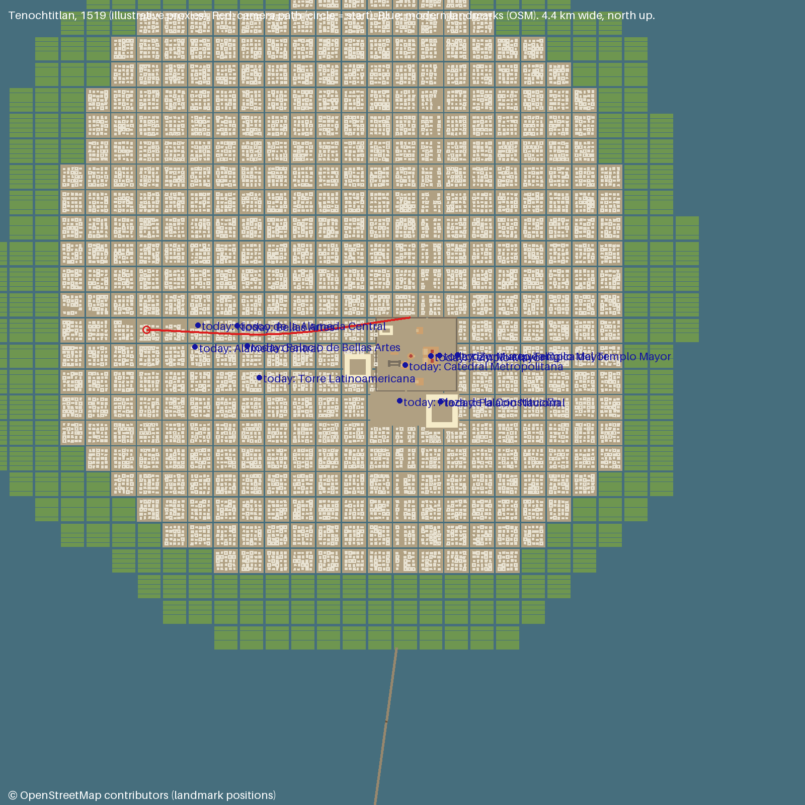
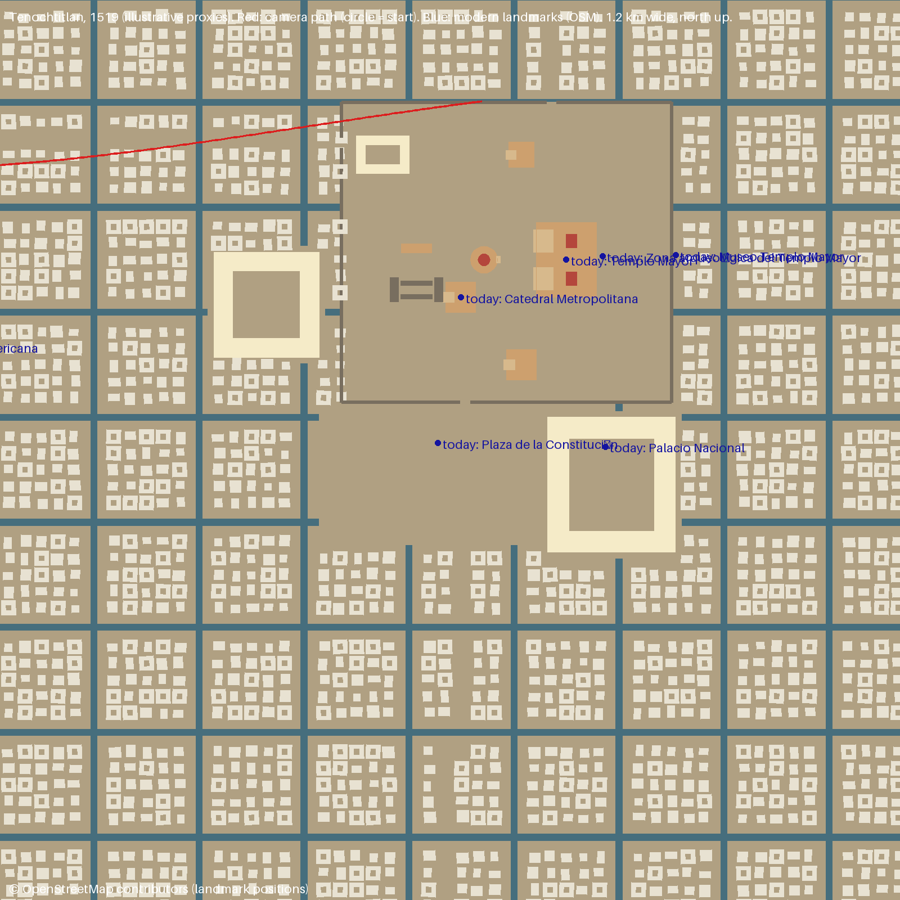

# Tenochtitlan 1519: proxy layout for author review

Manifest: `places/tenochtitlan_zocalo/eras/1519.json`. Built by `timeflight/era/build.py`. Plans are
made with `scripts/plan_view.py`. These are **massing proxies** that give the video model layout and
scale. They are not a reconstruction, and the credits will say "illustrative".

Every element cites sources from `docs/sources_1519.md` (A1 to A3, C1, C2, D1, D2, OSM) and states a
confidence. `timeflight.era.manifest.validate` rejects elements without sources and sources with NC,
SA or all-rights-reserved licences.

## What to check (status: approved by the author 2026-10-17)

The author approved the layout as is. The western shoreline and the canal grid stay explicitly illustrative,
since no exact micro-topographical record exists. D2 now names the Matos Moctezuma publications.

| # | Element | What the proxy does | Sources | Confidence | Question for you |
|---|---|---|---|---|---|
| 1 | **Anchor** | Everything is placed relative to the Templo Mayor ruins at 19.43489, −99.13172 (OSM way 1423783282) | OSM | high | – |
| 2 | **Templo Mayor** | 80 m E–W × 100 m N–S base, 4 terraces to 30 m, twin west stairways, shrines to 45 m (Tlaloc north, Huitzilopochtli south) | D2, D1 | medium | We use the low end (45 m) of 45–60 m. OK? |
| 3 | **Precinct** | Walled 440 × 400 m. It runs from 300 m west to 140 m east of the Templo Mayor, and from 190 m south to 210 m north of it. Wall 4 m. Gates: west on the Calle Tacuba line, south toward Iztapalapa, north toward Tepeyac | D2, D1, A1 | illustrative | Is the placement acceptable? Its south wall falls about 60 m north of today's Zócalo centre |
| 4 | **Other precinct buildings** | Ehecatl round temple 110 m west on the axis; ballcourt (E–W) and tzompantli about 200 m west; Temple of the Sun under today's Catedral; two generic temples north and south; Calmecac in the NW corner | D1 | illustrative / low | Positions are guesses inside the walls. Any you want moved or dropped? |
| 5 | **Plaza** | Open ground south of the precinct (today's Zócalo) | D1 | illustrative | – |
| 6 | **Palaces** | Moctezuma II: courtyard complex on the Palacio Nacional site, 170 × 180 m, 9 m. Axayácatl: 140 × 140 m, west of the precinct (Monte de Piedad) | D1, C1, C2, OSM | medium / illustrative | – |
| 7 | **Island** | 12.9 km² polygon (D1: 8–13.5 km²), west edge near Av. Bucareli, Tlatelolco included in the north | A1, A2, D1 | illustrative | Approved in principle (illustrative shoreline) |
| 8 | **Lake** | Flat water at +6 m above today's Zócalo ground. Today's DEM floods the old lake bed; Peñón de los Baños (Tepetzinco) becomes an island | A1, A2, D1 | illustrative | – |
| 9 | **Canals** | Regular grid: 130 m blocks, 10 m canals. Chinampa strips in a 350 m band along the shore | C1, D1 | illustrative | A regular grid is a simplification. OK for a 15 s flyover? |
| 10 | **Houses** | 22 m lots. 75% one-storey (3–4 m), 25% courtyard houses (5–7 m). No houses within 12 m of causeway axes (avenues) | C1, D1, A3 | medium | – |
| 11 | **Causeways** | 11 m wide, 2 m above water, bridge gaps every 600 m. West: along Tacuba / Hidalgo / Puente de Alvarado to Tacuba. South: Pino Suárez / Tlalpan line. North: toward Tepeyac | C1, C2, D1 | low | Routes are the common modern-street claim, still unsourced (see sources_1519.md) |

## Known simplifications
- Modern ground is pushed under the island, so the island is a flat platform at +7.5 m. Subsidence is not modeled.
- The hero path starts about 800 m inside the island, above today's Av. Hidalgo, so the Tlacopan causeway over open
  water is behind the camera. The flight follows its in-city continuation (the avenue) to the precinct's west gate.
- No aqueduct, no lakeshore towns, no dikes (e.g. Nezahualcóyotl's). They can be added as more manifest elements.
